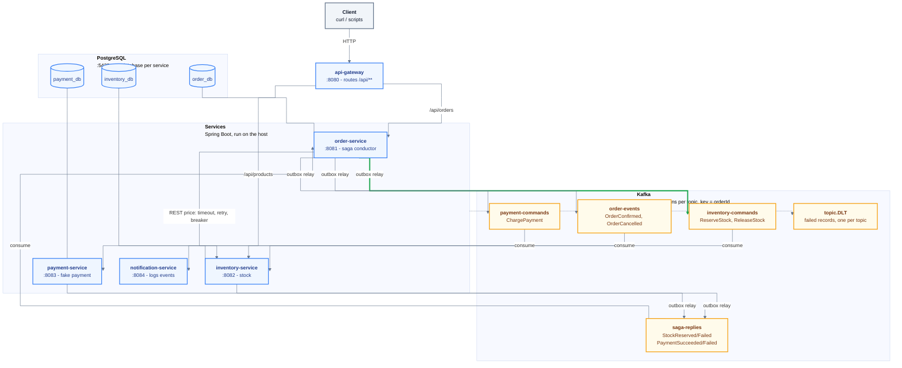
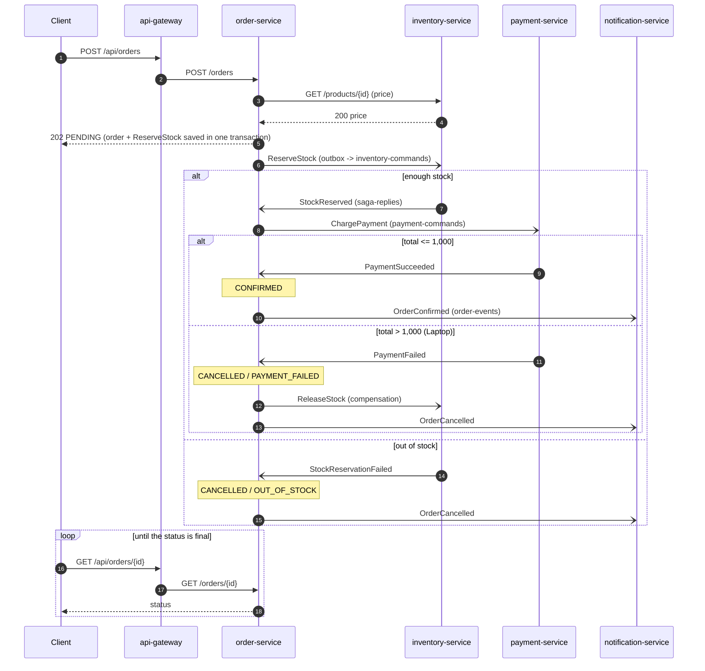
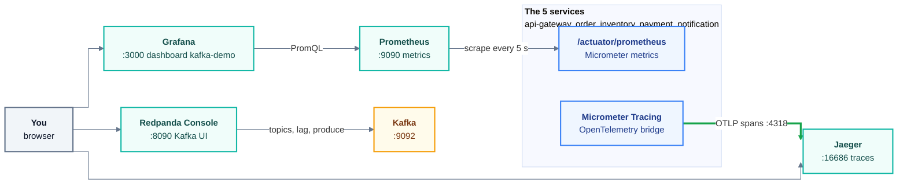

# Kafka microservices demo

A learning project: five Spring Boot services that run an order through an
orchestrated **saga** over **Kafka**, built step by step to learn the patterns a
Java backend interview asks about - and to measure them, not just read about
them. What I learned, written for a beginner: [`docs/LEARNINGS.md`](docs/LEARNINGS.md).

## What it shows

| Pattern | Where to read about it |
|---|---|
| Kafka basics: topics, partitions, keys, consumer groups, rebalance | [LEARNINGS 1-3](docs/LEARNINGS.md#1-kafka-basics) |
| Transactional outbox (no dual write) | [LEARNINGS 8](docs/LEARNINGS.md#8-the-outbox-pattern) |
| Idempotent consumer (duplicates are skipped) | [LEARNINGS 9](docs/LEARNINGS.md#9-the-idempotent-consumer) |
| Retries, poison messages, dead-letter topics | [LEARNINGS 10](docs/LEARNINGS.md#10-retries-poison-messages-and-the-dead-letter-topic) |
| Orchestrated saga with compensation | [LEARNINGS 13](docs/LEARNINGS.md#13-the-saga-orchestration-and-compensation) |
| Asynchronous API (202 + polling) | [LEARNINGS 14](docs/LEARNINGS.md#14-the-asynchronous-api-202--polling) |
| API gateway (Spring Cloud Gateway) | [LEARNINGS 17](docs/LEARNINGS.md#17-the-api-gateway) |
| Timeout, retry, circuit breaker (Resilience4j) | [LEARNINGS 18](docs/LEARNINGS.md#18-timeout-retry-and-circuit-breaker-resilience4j) |
| One trace across HTTP, Kafka and the outbox (OpenTelemetry, Jaeger) | [LEARNINGS 19](docs/LEARNINGS.md#19-tracing---micrometer-tracing-opentelemetry-jaeger) |
| Metrics and a dashboard (Prometheus, Grafana) | [LEARNINGS 20](docs/LEARNINGS.md#20-metrics---prometheus-and-grafana) |

Interview Q&A and a 2-minute project pitch are at the end of LEARNINGS.

## Architecture



The green arrow is the first outbox hop, and every "outbox relay" arrow works the
same way: a service never sends to Kafka inside a request or a listener - it saves
its data and the message in one transaction, and a relay sends the message (sources of all diagrams: `docs/*.mmd`).

### The order saga



### Observability



## Run it (Windows, PowerShell)

Requirements: Docker Desktop running, JDK 21 at
`C:\Program Files\Eclipse Adoptium\jdk-21.0.4.7-hotspot` (the scripts use it).

```powershell
.\scripts\start-infra.ps1        # Kafka, Redpanda Console, PostgreSQL, Jaeger, Prometheus, Grafana
.\scripts\start-services.ps1     # builds, starts the 5 services, waits until all are ready
.\scripts\e2e-check.ps1          # happy path + both failures, end to end, through the gateway
Invoke-RestMethod -Method Post http://localhost:8080/api/orders -ContentType 'application/json' -Body '{"productId":1,"quantity":2}'
Invoke-RestMethod http://localhost:8080/api/orders/<id>
.\scripts\stop-services.ps1
docker compose stop
```

Products (seed data): 1 Keyboard (50, happy path), 2 Monitor (300, only 5 in
stock), 3 Laptop (1,500 - payment always fails, stock is put back), 4 Sold-out
mug (always out of stock).

| What | Where |
|---|---|
| api-gateway (use this) | http://localhost:8080/api/products/1, /api/orders/{id} (POST /api/orders to order) |
| order / inventory / payment / notification | http://localhost:8081 / 8082 / 8083 / 8084 (`/actuator/health`) |
| Redpanda Console (Kafka UI) | http://localhost:8090 |
| Jaeger (traces) | http://localhost:16686 |
| Prometheus | http://localhost:9090 |
| Grafana dashboard | http://localhost:3000/d/kafka-demo |
| PostgreSQL | localhost:5433, user `demo`, password `demo` |

Helper scripts: `send-orders.ps1` (many orders), `outbox-status.ps1` (outbox rows
waiting, per database), and
`start-instance.ps1 -Service inventory-service -Port 8092 -ExtraArgs '--demo.processing-delay-ms=15000'`
(one more inventory instance, slowed down - for experiments).

## Experiments

Every experiment was run and written up ("What I saw") in LEARNINGS.

| # | What | Result in short | LEARNINGS |
|---|---|---|---|
| E1 | Kill inventory after its commit, before the offset commit | same offset redelivered, skipped as a duplicate, stock taken once | 9 |
| E2 | Produce `hello` to a topic | in the DLT 5 ms later, no retries; the next order went through | 10 |
| E3 | Produce the same message twice | both copies skipped | 9 |
| E4 | Stop Kafka, place orders | 202 in ~20 ms; sent 0.5 s after Kafka came back | 8 |
| E5 | 3, then 4 inventory instances | one partition each; then one consumer idle (an old one, not the newcomer); full reshuffle | 3 |
| E6 | 500 orders against a slow consumer | lag peaked at a few hundred, drained at 4.6 msg/s | 11 |
| E7 | Follow one order's messages | same key, same partition number in every topic (only because every topic has 3 partitions) | 2 |
| E8 | Stop inventory, keep ordering | breaker OPEN, 503 in ~35 ms, HALF_OPEN after 10 s, CLOSED again | 18 |
| E9 | One order in Jaeger | one trace, 20 spans, 5 services, across every outbox | 19 |

## Tests

```powershell
. .\scripts\use-jdk21.ps1
.\mvnw.cmd test
```

106 tests: messaging-contracts 11, inventory 27, order 54, payment 7,
notification 3, gateway 4. The integration tests start real PostgreSQL and Kafka
with Testcontainers (Docker must be running).

## Project structure

```
messaging-contracts/   topic names, message types, payload records, the JSON envelope codec
api-gateway/           Spring Cloud Gateway: routes /api/** + access-log filter
order-service/         orders, the saga conductor, the price call (Resilience4j)
inventory-service/     products and stock reservation
payment-service/       fake payment (fails over 1,000)
notification-service/  logs order events (no database)
docker-compose.yml     Kafka, Redpanda Console, PostgreSQL, Jaeger, Prometheus, Grafana
prometheus/, grafana/  scrape config, provisioned data source and dashboard
scripts/               start/stop, experiments, end-to-end check (PowerShell)
docs/                  LEARNINGS, implementation notes, diagrams, spec and plans
```

## How it was built

| Milestone | Scope |
|---|---|
| M1 | Kafka basics: order and inventory exchange messages (E5, E7) |
| M2 | Reliability: outbox, idempotent consumers, retries and DLT (E1-E4, E6) |
| M3 | Full saga: payment, compensation, notifications, end-to-end check |
| M4 | Gateway, Resilience4j, tracing and metrics (E8, E9) |
| M5 | Health probes, this README, interview Q&A |

Design: `docs/superpowers/specs/`; one plan per milestone in
`docs/superpowers/plans/`; decisions and changes during the build:
`docs/implementation-notes.md`.

## Notes

- Docker Hub downloads failed on my network; the images were pulled from Google's
  mirror (`mirror.gcr.io`) and checked by digest - see implementation notes.
- Builds use JDK 21 (a newer default JDK broke Mockito's inline mocks).
- The diagrams use a Mermaid init block: GitHub renders them, but some editor
  previews (e.g. a VS Code extension) show a blank box.
